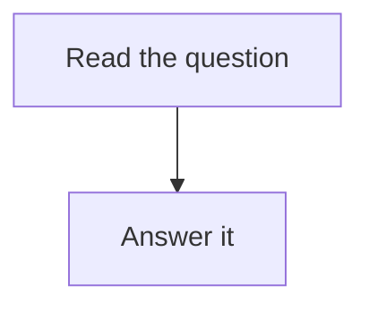

The rendered check's handout (plantoir-rendered-check-597).

## Question 1

What is $19 + 23$?

> [!success]- Answer 1
> $42$

![[Rendered Check Picture.png]]

The worksheet as a file: [[Rendered Check Handout.pdf]]
