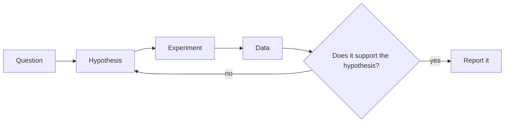
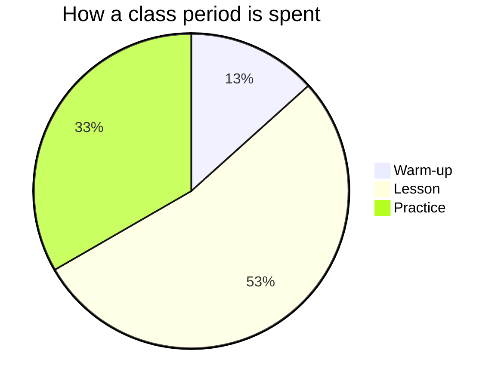
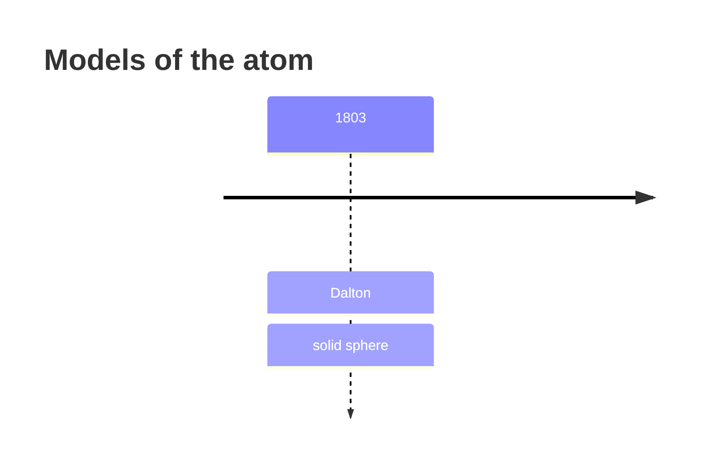
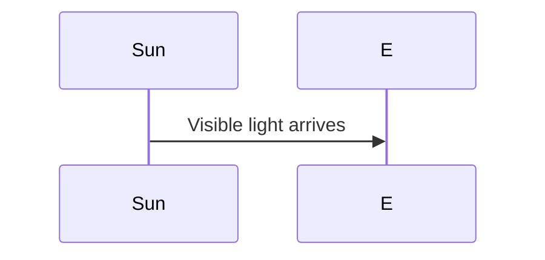

A page can show a flowchart, a pie chart, a timeline or a sequence diagram that is drawn from a few lines of text. You type the lines in a block on the page. This page gives the form of the block and the kinds of diagram the ready-made courses use.

> [!note]
> The examples on this page stop before the block's last line. Remember the three backticks that close the block.

## Write a flowchart

1. In Obsidian, on a line of its own, type three backticks and the word `mermaid`.
2. Type the diagram's lines. The first says what kind of diagram it is.
3. End the block with a line of three backticks. A block holds one diagram.

```text wrap


In this flowchart:

- `graph LR` makes a flowchart that runs from left to right. `graph TD` runs from top to bottom.
- `["…"]` makes a box, and `{"…"}` makes a decision diamond.
- `-->` draws an arrow, and `-->|yes|` puts a label on the arrow.

Put every label in double quotes. A bracket, a comma, a colon or an accent in a label without quotes stops the diagram from drawing.

{{picture:diagrams-from-text-1}}
alt: The lines of a flowchart as typed, beside the flowchart students see on the class website.

## Other kinds of diagram

The block is the same. Its first line changes.

A pie chart:

```text wrap


A timeline:

```text wrap


A sequence:

```text wrap


Flowcharts are by far the most used in the ready-made courses, then pie charts, timelines and sequences. A block may also begin `stateDiagram-v2` or `gantt`.

{{picture:diagrams-from-text-2}}
alt: A timeline on the class website of a ready-made course, drawn from a few lines of text.

For a pie chart:

- Keep to a few slices. A slice under about three per cent prints its label on top of its neighbour's.
- Keep the title short. A long title is fitted in, not cut off, but a short one leaves the pie larger.
- Do not choose colours. The website colours the slices from the section's colour scheme.

A graph of a function, a geometry figure or a circuit is not this kind of diagram. See [Diagrams and graphs](page:figures).

## What students see

Students see the diagram drawn on the page, in the section's colours, in light or dark mode. On paper a diagram prints as a picture, with no box around it.

## Check your work

Preview the section and look at the page. If a preview is already running, choose {{menu:rebuildPreview}}.

If a diagram is not drawn:

- Check that every label is in double quotes, then preview again.
- Check that the page has no two per cent signs together, `%%`. Text between two such pairs is taken off the page. That is so inside a diagram as anywhere else.

The section's {{control:problemsTab}} tab does not name a diagram of this kind that could not be drawn, so look at the page itself.

## See real ones

Every ready-made course has a page named What This Site Can Do, in its Style folder, with a part named Diagrams. The example course's page has a flowchart, a cycle, a pie chart, a sequence and a timeline, each under a heading of its own. See [Look around with the example course](page:example-course).
