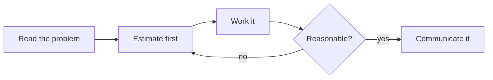
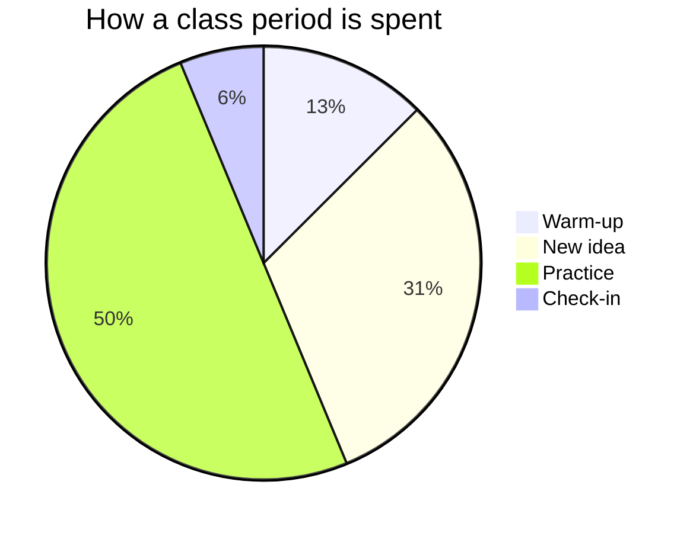

# Writing pages for a Plantoir class website

This working folder holds courses for Plantoir, which turns each course
(`courses/<CODE>/`, an Obsidian vault of Markdown pages) into a class
website - one site for each section of the course. Everything a page can
do is written as plain Markdown in the page itself: there is no separate
editor, no picture of an equation, and nothing to install. Every example
below is copied from a page Plantoir really built.

This file is managed by Plantoir and is replaced when Plantoir updates; do
not edit it.

## 1. Read a feature skill as well, when the page needs one

This skill is the map. Four features have a skill of their own, with
complete patterns to paste and the limits that matter; read the one that
matches before writing that part of the page, rather than guessing from
here:

| The request mentions | Read |
|---|---|
| a worksheet, handout, practice set, answer key, "students will print", or handing out an existing PDF | `plantoir-printing` |
| a graph of a function, a geometry figure, similar triangles, a number line, a probability tree, a circuit, anything "plotted" or "drawn" | `plantoir-math-graphs` |
| a quiz, a 5-question check, practice questions students check themselves, an exit ticket, multiple choice, fill in the blank | `plantoir-quizzes` |
| "make this example runnable", a Python or Swift program students run in the browser, "try it yourself" | `plantoir-runnable-code` |

Each is at `.claude/skills/<name>/SKILL.md` (and `.agents/skills/<name>/SKILL.md`)
in this working folder. A flowchart or timeline is a diagram (section 6
here), not a maths figure. A handout made as a PDF rather than a page -
usually including a quiz or test for marks - is the
`plantoir-handouts` skill; when a teacher asks for something to print,
offer its house style alongside `plantoir-printing`.

## 2. Where a page goes

```
courses/<CODE>/
  Concepts/            a folder every section shares (one sidebar entry each)
    index.md           the folder's own front page
    Slope.md           a page
  Media/               pictures, PDFs and video files for every page
  section1/
    All Classes/       this section's class pages: "Unit 2, Day 3.md"
    Key Links.md       this section's list of shortcuts
  section2/ ...
```

- **Make a page by making a `.md` file** in the folder it belongs to. The
  file's name is the page's name, and the name other pages link to: keep
  it short and plain (`Slope.md`, `Solving Two-Step Equations.md`). Two
  pages with the same name in different folders make links ambiguous - pick
  a different name.
- **A new folder** beside the others becomes a new entry in the sidebar on
  the next preview. Give it an `index.md` (section 19).
- **Per-section pages** live under `section<N>/` - the class pages and Key
  Links. Everything else is shared by every section; whether each section
  shows it is the page's own setting (section 18).
- Follow the folder's existing pages: open two neighbours and copy their
  settings block and headings, so the new page reads like the rest of the
  course.

## 3. Page settings

The block between two `---` lines at the very top is the page's settings.
It must be the first thing in the file.

```markdown
---
title: Slope as a Rate of Change
tags:
  - concepts
  - unit-2
enableToc: false
---
The **slope** of a line is how much $y$ changes for each step in $x$.
```

- `title:` is what the page is called on the site; without it the file
  name is used.
- `enableToc: false` turns off **Navigate this page**, the list of the
  page's headings shown beside it. Leave it out on a long page: every `##`
  heading is listed there automatically.
- A page with no `publish:` line is on the site. Section 18 says how to
  hold one back.
- Leave `created:` (and any `createdSection1:`, `createdSection2:` ...) as
  the neighbouring pages have it, or leave it out: a page a class page
  links to takes that class's date when the site is built (section 20).

## 4. Text

```markdown
**bold**, *italic*, ~~struck through~~ and ==highlighted== text.

Arrows typed as -> and => become arrows: estimate -> refine -> check.

Press <kbd>Ctrl</kbd> + <kbd>K</kbd> to search the site.
```

`==highlight==` is the one to reach for when a single key term should stand
out in a paragraph. Headings are `##` for a section and `###` under it;
leave `#` alone - the page's title is already its top heading.

## 5. Callouts

A callout is a box that pulls something out of the flow of the page, each
kind with its own colour and icon. **Every line of it starts with `>`**,
the kind goes in square brackets with `!`, the title follows on the same
line, and an empty line comes before and after it.

```markdown
> [!warning] Where people usually go wrong
> Subtracting a negative: $5 - (-3)$ is $5 + 3$, not $5 - 3$.

> [!tip]
> A callout with no title is titled with its kind.
```

The kinds: `note`, `abstract` (also `summary`, `tldr`), `info`, `todo`,
`tip` (also `hint`, `important`), `success` (also `check`, `done`),
`question` (also `help`, `faq`), `warning` (also `caution`, `attention`),
`failure` (also `fail`, `missing`), `danger` (also `error`), `bug`,
`example`, `quote` (also `cite`). A kind not on this list shows as a plain
`note`-coloured box with its own name as the title.

**Foldable**: a `-` after the bracket starts it folded shut, a `+` starts it
open with a fold button. Use folded callouts for worked answers, so
students try before they peek:

```markdown
> [!success]- Worked answer (select to open)
> $\frac{3}{4} + \frac{5}{6} = \frac{9}{12} + \frac{10}{12} = \frac{19}{12}$

> [!example]+ Example 2, open to start
> $2x + 3 = 11$, so $2x = 8$ and $x = 4$.
```

A callout inside a callout adds a `>` per level (`> > [!hint]- Hint`).
`[!quiz]`, `[!answer]` and `[!explain]` are the quiz skill's: read
`plantoir-quizzes` before writing one. A printable page's answer callouts
are the printing skill's.

## 6. Diagrams: flowcharts, timelines, pie charts

A diagram is written, not drawn, in a ` ```mermaid ` fence:

````markdown

````

- **Put every label in double quotes** - `A["Plan (5 min)"]`. Brackets,
  commas, colons and accents in an unquoted label stop the diagram from
  drawing.
- `graph LR` runs left to right, `graph TD` top to bottom. One diagram per
  fence.
- Other kinds use the same fence: `pie title ...` with `"Label" : 40`
  lines, `timeline` with `1557 : Recorde invents the equals sign` lines,
  `sequenceDiagram`, `stateDiagram-v2`.



A graph of a function, a geometry figure, a number line or a circuit is NOT
a Mermaid diagram: read `plantoir-math-graphs`.

## 7. Tables

```markdown
| Representation | Shows best | Hides |
| --- | --- | --- |
| Table of values | Exact pairs | The overall shape |
| Equation $y = mx + b$ | The rule itself | What it feels like |
```

The row of dashes under the headings is what makes it a table. Maths works
in a cell; a `|` inside a cell must be written `\|`. Keep each row on one
line.

## 8. Mathematics

Single dollar signs keep maths in the sentence; double dollar signs, **each
on a line of its own**, give it a centred line:

```markdown
The slope is $m = \frac{\Delta y}{\Delta x}$, so each step across climbs $m$.

$$
\text{slope} = \frac{17 - 5}{6 - 2} = 3
$$

Chemistry works too: $\ce{2H2 + O2 -> 2H2O}$.
```

- It is LaTeX-style: `\frac`, `\sqrt`, `^`, `_`, `\times`, `\le`,
  `\begin{aligned} ... \end{aligned}` inside `$$`, `\text{...}` for words.
- **Money**: two dollar amounts in one paragraph are read as maths between
  them. Write `\$5` for a price.
- No space just inside a single dollar sign: `$x + 1$`, not `$ x + 1 $`,
  which the site typesets but Obsidian shows as plain text.
- Never write `%%` anywhere on a page, maths included (section 17). Use one
  `%` only inside maths where LaTeX needs it, written `\%`.

## 9. Code

A fenced block with the language named after the three backticks is shown
exactly as written, coloured, with line numbers down the left:

````markdown
```python
def slope(x1, y1, x2, y2):
    return (y2 - y1) / (x2 - x1)

print(slope(2, 5, 6, 17))   # 3.0
```

In a sentence, `print()` in single backticks is code too.
````

- Name the language (`python`, `java`, `javascript`, `html`, `css`, `swift`,
  `cpp`, `sql`, `bash` ...) so it is coloured; a block with no language is
  plain.
- The site never joins characters into one symbol, so `!=`, `->` and `<=`
  show as typed, in blocks and in sentences alike.
- Never write `%%` in code (section 17): it is taken off the page.
- Code that students RUN in the browser - "make this runnable", "try it
  yourself" - is the `plantoir-runnable-code` skill's ` ```python run `
  block, not this one.

Plain text whose lines are long - an error message, sample output, a
paragraph to copy - can wrap instead of scrolling sideways: write `text wrap`
after the backticks.

````markdown
```text wrap
FileNotFoundError: [Errno 2] No such file or directory: 'scores.csv' - the program looked in the folder it was started from, not the folder the file was saved in.
```
````

- Each line keeps its number; a line that wraps shows … beside its later
  rows. Copying the block copies the lines as written.
- Only `text` wraps. Code never does, because code is read by column, and
  `wrap` after any other language (` ```python wrap `) is ignored.

## 10. Checklists students tick

```markdown
- [ ] Estimate before calculating
- [x] Units carried through the whole solution
- [ ] Answer sentence written
```

On the site each student can tick the boxes; the ticks stay in that
student's own browser, nobody else sees them, and they are still there
when the student comes back. A box written `[x]` starts ticked. **Changing
a line's words clears that line's tick** for every student, so fix typos
before students start. Boxes inside a `[!quiz]` callout are quiz choices,
not a checklist.

## 11. My Progress: success criteria students tick

From Plantoir 1.8.2, each section's site can have a page called **My
Progress**, where a student sees how many of the success criteria they have
ticked on each page of the course - for their eyes only.

**What the student sees.** One My Progress page per section, listed in the
sidebar directly after the class folder (All Classes in a course), so second
on most sites, and as the first bullet of Key Links. The page itself shows
no date. It lists every page that has success criteria, each row reading
done / total ("2 / 5") with a link back to the page, so a student ticks
boxes only on the page itself, with the lesson in view - My Progress has no
boxes of its own. Rows are grouped by the class page that first linked
each page (the earliest class that links it directly), one closed table per
unit with totals at the top; pages no class links directly (or only a
hidden or undated class does) come last, under **Other pages**. The ticks live in the student's own browser - nothing is
sent anywhere, and a different browser or device starts again. Until a
student ticks something, each row counts only the items the teacher wrote
already ticked (`[x]`): a page with none reads "0 / n".

**My Progress appears only when there is something to show**: Plantoir adds
the page, its sidebar entry and its Key Links bullet only once at least one
page students can see has a checklist under a success-criteria heading. Do
not write a My Progress page or link yourself - Plantoir does both, and a
page of the course's own called My Progress stops Plantoir writing its own.

**How to write a page so its items count** - a complete page:

```markdown
---
title: Finding Slope
tags:
  - concepts
---
The slope of a line is $m = \frac{\Delta y}{\Delta x}$.

## Success criteria

- [ ] I can find the slope from two points
- [ ] I can say what the slope means in the situation
- [x] I can tell a positive slope from a negative one on a graph

## Practice

- [ ] Questions 1 to 5 (a checklist, but not a success criterion)
```

- **The heading** is one of `Success criteria`, `Test of success` or `Tests
  of success`, at any level (`##`, `###`, ...). Capitals and a trailing
  colon or full stop do not matter (`### Tests of success:` counts). A
  course can use its own list of headings instead - the
  `success_criteria_headings` list in `courses/<CODE>/course_config.json`,
  which REPLACES the three; if it is there, use one of its headings.
- **The items** are task lines, `- [ ] I can ...`, each with words after
  the box, from that heading down to the next heading of the same or a
  higher level; a deeper heading stays inside it. The same words twice on
  one page count once. A checklist under any other heading (the Practice
  list above) does not count.
- **The heading must be on the page itself, at the left edge** - not
  inside a callout, a quote or a list. Items inside a callout under the
  heading do count; boxes inside a `[!quiz]` never do.
- **Items are counted on the page they are written on.** A checklist shown
  on another page with `![[Page#Success criteria]]` is still the first
  page's: it is counted once, under that page.
- **A teacher's `[x]` counts as done** from the start, until the student
  unticks it. So the example page above reads **1 / 3** before a student
  ticks anything; write `[ ]` for every item unless one really is done.
- **Changing an item's words** clears every student's tick on that item
  (section 10) and the old tick is no longer counted.
- **Does not count:** a table under the heading (only checklist boxes are
  counted), items under another heading, a page held back with
  `publish: false`, and every page of a section where My Progress is
  switched off (the page is then not built at all). That switch is
  `include_my_progress` in `courses/<CODE>/course_config.json`, read the
  same way as `include_curriculum_coverage`: `false` turns it off for every
  section, or a map turns it off for one section - `{"sections": {"section2":
  false}}` (or `{"section2": false}`, or `{"default": false}` for every
  section the map does not name). No key, or a map that does not name the
  section, means on. Change it only if the teacher asks.
- Write each item as something a student can honestly tick: "I can ...".

## 12. Links between pages

Link to another page of the course with double square brackets around its
name - not its folder, and without `.md`:

```markdown
See [[Slope]] before class.
Read [[Slope|what slope means]] first.
The method is in [[Slope#Finding the slope from two points]].
A website: [the Desmos calculator](https://www.desmos.com/calculator).
```

- `[[Page|words]]` shows other words; `[[Page#Heading]]` jumps to a
  heading (copy the heading's words exactly).
- Use `[[...]]` for the course's own pages and `[words](https://...)` for
  other websites. A `[words](Other Page.md)` link to a page breaks on a name
  with a space: use `[[...]]`.
- **Hover previews**: on the site, resting the pointer on a link to a page
  shows that page in a small window, so a student can check a definition
  without losing their place. Nothing to write - every `[[...]]` does it.
- **Backlinks**: at the bottom of every page the site lists every page that
  links to it, by itself. Nothing to write.
- A link to a page held back from students (section 18) leads nowhere on
  the site; Plantoir lists such links in its check of the site after a
  preview.

## 13. Showing one page inside another

An exclamation mark in front of a link shows that page (or one heading of
it) in place, kept up to date - change the source and every page showing it
changes:

```markdown
![[Slope]]

![[Slope#Finding the slope from two points]]
```

Use it for something many pages need - a curriculum expectation, a
shared set of instructions, a checklist - instead of copying it. A page
shown this way is a quoted block with a link back to its own page.

## 14. Footnotes

```markdown
The word "algebra" comes from Arabic.[^1]

[^1]: From *al-jabr*, "the reunion of broken parts".
```

The `[^1]:` line can go anywhere on the page; the footnote is listed at the
bottom. Each footnote needs its own label (`[^1]`, `[^2]`, `[^source]`).

## 15. Tags

Tags go in the page's settings, one per line, with no `#` and no spaces
(use hyphens):

```markdown
---
title: Practice - Two-Step Equations
tags:
  - exercises
  - unit-2
---
Practise solving two-step equations.
```

Every tag becomes a page on the site listing everything carrying it, and
the tags show at the top of the page. Follow the tags the course's other
pages already use.

## 16. Pictures, PDFs, videos and applets

**Pictures and files go in the course's `Media` folder** (`courses/<CODE>/Media/`,
beside the course's other folders, made if it is not there). The site
gets every file in it; the sidebar never lists it. Then:

```markdown
![[cell-diagram.png]]

![[cell-diagram.png|300]]


![[Unit 2 Review.pdf]]

[[Unit 2 Review.pdf|Download the review sheet]]
```

- `![[name.png]]` shows the picture; `|300` sets its width in pixels.
- **Describe what a picture shows** for students who cannot see it: the
  `` form carries a description.
- `![[name.pdf]]` shows the PDF in a frame on the page; `[[name.pdf|words]]`
  is a link to it. A worksheet to print is the printing skill's.
- File names: letters, digits, spaces and hyphens. Never point at a picture
  on another website or on the teacher's own computer
  (`/Users/...`, `C:\...`) - copy it into `Media`.

**Videos and applets** need the internet when a student opens the page,
and do not print:

```markdown


<iframe src="https://player.vimeo.com/video/22439234" width="640" height="360" allow="fullscreen; picture-in-picture" allowfullscreen></iframe>

<iframe src="https://www.geogebra.org/material/iframe/id/x8XV6rzq" width="800" height="500" allowfullscreen style="border: 1px solid #e4e4e4"></iframe>

<iframe src="https://phet.colorado.edu/sims/html/projectile-motion/latest/projectile-motion_all.html" width="800" height="600" allowfullscreen></iframe>
```

- **YouTube**: the picture form `` with the video's ordinary
  address (`youtube.com/watch?v=...` or `youtu.be/...`) becomes the player.
- **Vimeo, GeoGebra and PhET**: paste the `<iframe ...></iframe>` the site's
  own Share or Embed button gives, **on one line, with an empty line before
  and after**. For Vimeo the address is `player.vimeo.com/video/<number>`,
  for GeoGebra `www.geogebra.org/material/iframe/id/<id>`, for PhET the
  simulation's `..._all.html` address.
- A video file of the teacher's own goes in `Media` and is shown with
  `![[clip.mp4]]`.
- For a graph students read rather than an applet they play with, prefer
  the figures in `plantoir-math-graphs`: they work offline and print.
- A page that also has runnable code that reads input: read
  `plantoir-runnable-code` - a video, PDF frame or applet on the page
  changes how students type their input.

## 17. Notes only the teacher sees

Text between `%%` marks is kept in Obsidian and never reaches the site:

```markdown
%% Tomorrow: swap the second example for one with a negative slope. %%
Students see only this sentence.
```

Because of this, never write `%%` for any other reason on a page - not in
maths, code or a percentage.

## 18. Hidden pages and `publish:`

```markdown
---
title: Unit 3 Test Review
publish: false
---
Not on the site until `publish: false` is removed or set to `true`.
```

- `publish: false` keeps a page off every section's site: write next week's
  lesson today and publish it when ready. **No `publish:` line means the
  page is on the site**, so forgetting it never makes work vanish.
- `publishForSection2: false` holds a shared page back from section 2 only,
  and wins over `publish:` for that section.
- An old page may say `draft: true`. That is the OLD spelling and means the
  opposite - hidden. Do not add `draft:` to a page; use `publish:`.
- Hidden from students is not the same as hidden from the sidebar: a
  folder or page can be left out of the sidebar in Plantoir's Course
  Settings and still be on the site, reached by links and search.

## 19. Folders, the sidebar and a folder's front page

Each folder of the course is an entry in the site's sidebar, and its
`index.md` is the page that opens when a student chooses it:

```markdown
---
title: Concepts
---
The clean statement of each idea, in the order the course needs them.

- [[Slope]]
- [[Rate of Change]]
```

- Below the front page's own words the site lists every page in the folder.
  `renderFolderPages: false` in its settings turns that list off, for a
  front page that lists its pages itself.
- Whether a folder opens out in the sidebar, or is hidden from it, is set in
  Plantoir's Course Settings, not in a page.
- A page with no folder (straight in `courses/<CODE>/`) is listed at the
  bottom of the sidebar.

## 20. Class pages, and the dates they give

Each section's class pages are in its class folder (usually
`section<N>/All Classes/`), named in the course's own words: `Unit 2, Day 3`
(a course may say Thread, Module or Meeting instead of Unit - follow the
existing names exactly, as Plantoir numbers them). A class page is an agenda
that links to the day's pages:

```markdown
---
title: Unit 2, Day 3
enableToc: false
---
## Agenda

1. Warm-up: [[Slope Warm-Up]]
2. New idea: [[Slope]]
3. Practise: [[Slope Practice]]

## Before next class

- [ ] Finish questions 1 to 5 of [[Slope Practice]]
```

- **A page a class page links to directly takes that class's date** when
  the site is built (the earliest class, if several link it), and the date
  is written into the page's own settings: on a page every section shares
  (anything outside `section<N>/`) as `createdSection<N>:` for that section
  only - which the site reads instead of `created:` - and on a section's
  own page as `created:` (or its `createdSection<N>:`, if it has one). That
  date orders the page in its folder. A date typed by hand on such a page is
  replaced; another section's date is never touched.
- Add new class pages with Plantoir (or the assistant in it), which numbers
  them and moves later ones along; do not renumber class pages by hand.

## 21. Key Links

Each section's `section<N>/Key Links.md` is the short list of pages
students need all year - how the class works, how marks work, getting
help. It is a plain list of links:

```markdown
---
title: Key Links
---
- [[How This Class Works]]
- [[How Marks Work]]
- [[Getting Help]]
```

Add a bullet for a page that belongs there; leave the others alone.
Plantoir adds its own entries when it builds the site (the curriculum
coverage map, and My Progress from 1.8.2) - do not add those by hand.

## 22. Do not

- Do not write raw HTML for something Markdown already does (headings,
  lists, bold, tables, pictures): the site's styles and printing rely on
  the Markdown.
- Do not add a `<script>`, a `<style>` or an embed from a quiz, form or
  survey service; use the feature skills.
- Do not link to a page by its folder path (`[[Concepts/Slope]]`) unless two
  pages share the name.
- Do not edit `course_config.json` unless the teacher asks you to (Plantoir's
  Course Settings write it), or anything in a folder whose name starts with
  a dot.

## 23. Check it

Preview the section in Plantoir and open the page: every callout should be
a coloured box, every diagram drawn, every formula typeset, and every link
should go to a page. If something shows as plain text with its marks still
visible, compare it with the example above. Tell the teacher what you
added and that it is worth previewing before publishing.
