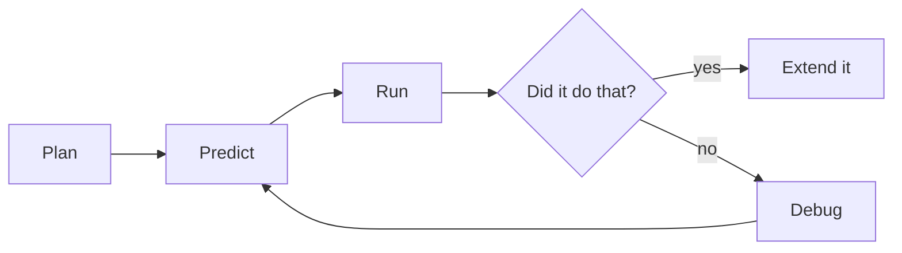
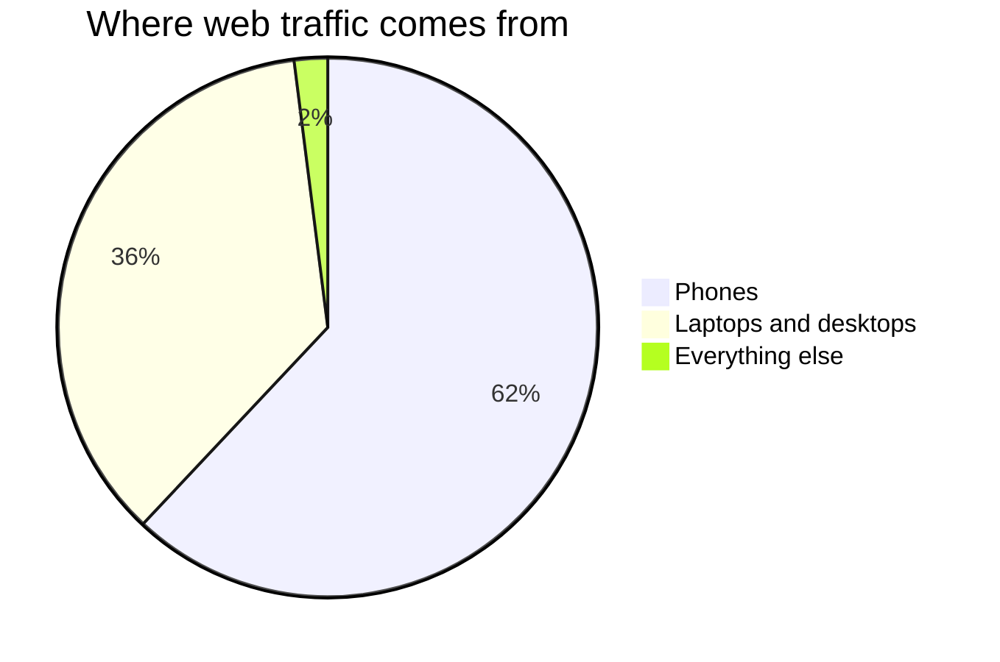
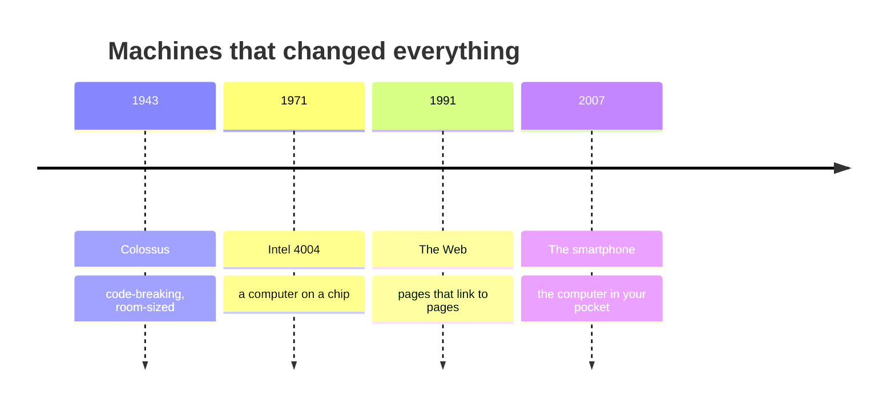

This page exists for two audiences. Students: it shows why the notes look
the way they do. Teachers: it is a working reference for everything you
can put in a page, with the source visible in every example.

Everything below is written in **Markdown** — plain text with a few marks
of punctuation that mean something. If you can write a text message, you
can write this.

---

## Text that carries meaning

You get **bold**, *italic*, ~~struck through~~, and ==highlighted== text.
Highlighting is the one worth knowing: it draws the eye better than bold
when you want a single ==key term== to stand out in a paragraph.

**How that was made:**

```markdown
**bold**, *italic*, ~~struck through~~, ==highlighted==
```

Arrows written as `->` become proper arrows: estimate -> refine -> check.

Keyboard keys look like keys: press <kbd>⌘</kbd> + <kbd>K</kbd> to search.

---

## Mathematics, typeset properly

Electronics runs on a little mathematics, and the site typesets it
exactly: inline like $V = IR$, or displayed:

$$
I = \frac{V}{R} = \frac{9\ \text{V}}{330\ \Omega} \approx 27\ \text{mA}
$$

**How that was made:** single dollar signs keep it in the sentence,
double ones give it a line of its own.
[[Electronics Calculations Practice]] leans on this everywhere.

---

## Code, coloured and exact

This is the feature a programming course lives on: runnable examples
with the spacing and quotation marks preserved, coloured by meaning:

```python
name = input("What is your name? ")
if len(name) > 0:
    print("Hello, " + name + "!")
else:
    print("Hello, mysterious stranger.")
```

**How that was made:** three backticks and the language name, the code,
then three backticks to close it. Every page in
[[Code/index|the Code folder]] uses this.

---

## Headings, and the table of contents

Every `##` heading on a page becomes a link in **Navigate this page**,
over on the right — built automatically from the headings, so it can
never fall out of step with the page. Deeper headings nest underneath.

A short page reads better without a contents panel; one frontmatter line
(`enableToc: false`) turns it off. Every class page in
[[All Classes/index|All Classes]] does this — an agenda of six items does
not need navigating.

---

## Callouts

Callouts pull something out of the flow of the page, each kind with its
own colour and icon:

> [!note] Note
> Neutral information worth setting apart.

> [!tip] Tip
> A shortcut, a habit, or something that makes the work easier.

> [!important] Important
> The one thing to take away if you take away nothing else.

> [!warning] Warning
> Where people usually go wrong — the classic sign-error traps live in
> these boxes.

> [!question] Question
> Something to think about rather than something to know.

> [!abstract] At a glance
> Used at the top of task pages for format and timing.

**How that was made:** a blockquote with the kind named in brackets.

```markdown
> [!warning] Where people usually go wrong
> The text of the callout goes here.
```

### Foldable callouts

Add a `-` to start a callout collapsed. Every practice set in
[[Exercises/index|Exercises]] hides its worked answers this way — try
before you peek, but the peek is always there:

> [!success]- Worked answer (click to expand)
> The loop runs 4 times — `range(4)` stops *before* 4 — so the program
> prints 0, 1, 2, 3. If you predicted a 4, you have just met the most
> famous off-by-one in programming.

```markdown
> [!success]- Worked answer (click to expand)
> The hidden solution.
```

---

## Diagrams

Diagrams are **written, not drawn** — edited in seconds, never needing a
graphics program.



**How that was made:**

````markdown

````

Proportions draw themselves too:



And history fits on a line:



---

## Tables

**How that was made:** rows of text separated by `|`, with a line of
dashes under the headings. Mathematics works inside cells, which matters
more than it sounds.

| Storage | Lives | Reaches you |
| --- | --- | --- |
| Local drive | On this machine | Only at this machine |
| Cloud | On someone else's machines | Anywhere you sign in |
| Version history | Alongside the file | Whenever you regret an edit |

---

## Checklists

**How that was made:** a list where each line starts with `- [ ]`, or
`- [x]` for one already done.

- [ ] Power off and unplugged before opening
- [x] Strap on before components leave their bags
- [ ] Screws bagged and labelled by step
- [ ] Someone else could service this build from your notes

On the site each student can tick them; the ticks stay in their own
browser, nobody else sees them, and changing a line's words clears its
tick. Ticked as you go, they are how [[Reading a Spec Sheet]] turns from
advice into habit.

---

## Links between pages

This is what makes the site more than a pile of documents.

- A plain link: [[Binary and Number Systems]]
- A link with different words: [[Binary and Number Systems|counting in twos]]
- A link to a section: [[Binary and Number Systems#Counting in twos]]

**How that was made:** double square brackets.

```markdown
[[Binary and Number Systems]]
[[Binary and Number Systems|different words for the link]]
[[Binary and Number Systems#Counting in twos]]
```

### Transclusion — one page inside another

**How that was made:** `![[Page name]]` — a link with an exclamation mark
in front of it.
%%curriculum-start%%
Here is a curriculum expectation, embedded live rather than copied:

![[A3.1]]

Change the source page and every page that embeds it updates. This is how
each task page shows the expectations it addresses without anyone
maintaining duplicates.
%%curriculum-end%%

### Backlinks

Scroll to the bottom of any page and you will find **Backlinks** — every
page that links *to* this one, gathered automatically. Open
[[Binary and Number Systems]] and its backlinks list every lab and
practice set that leans on it. Nobody maintains that list.

---

## Hover previews

Hover over [[Anti-Static Habits]] without clicking. The page appears in a
small window. Checking one definition mid-problem does not cost you your
place.

---

## Footnotes

**How that was made:** `[^1]` where the marker goes, and a matching
`[^1]:` line anywhere in the page.

The word "bug" predates computers.[^1]

[^1]: Engineers called mechanical faults "bugs" in the 1800s — but in
    1947, Grace Hopper's team taped an actual moth into their logbook
    after it jammed a relay in the Harvard Mark II: "first actual case
    of bug being found".

---

## Tags

**How that was made:** a `tags` list in the frontmatter at the very top
of the page.

```yaml
---
tags:
  - concepts
  - unit-2
---
```

Every tag becomes a page listing everything filed under it.

---

## What you cannot see

Two things on this page are invisible in the browser:

1. **Comments.** Text wrapped in `%%` double percent marks `%%` never
   reaches the site. Useful for notes to yourself in a page you are
   still writing — tomorrow's hint, next year's fix.
2. **Holding a page back.** A page with `publish: false` in its frontmatter
   is left out when the site is built. Write next week's lesson today and
   publish it when you are ready. A page with no `publish` line is published,
   so forgetting it can never make your work vanish.

%% This sentence is a comment. If you can read it on the website, something is broken. %%

> [!tip] For teachers reading this
> With more than one section, per-section keys like `publishForSection1` and
> `publishForSection2` let one shared page be published to one class and held
> back from another — useful when your two sections sit a few days apart.

---

## The point of all this

None of it is decoration. Each feature removes a reason for a page to be
out of date:

| Feature | The problem it solves |
| --- | --- |
| Coloured code | Screenshots of code nobody can copy or run |
| Transclusion | The same text copied into six places, five stale |
| Backlinks | "Where did we use this again?" |
| Folded answers | Solutions that spoil the attempt |
| Holding a page back | Next week's lesson in a separate file somewhere |

Write it once, link to it everywhere.
